# 2D CAN for HipMRI Prostate Segmentation 

## 1. Overview
The problem I am investigating is that manual contouring is extremely time-consuming and has high stake consequences.
The imaging specialist has to precisely outline where the prostate is on HipMRI images, so the machine knows exactly
where to aim. Under-contouring will risk tumour recurrence, and over-contouring can cause severe radiation toxicity.
We want to avoid harming the OARs, such as the bladder, in the process. This job is also very difficult since the 
boundaries are very visually ambiguous on the HipMRI scans, and the prostate makes up a small percentage of the
pelvic scan.

Consequently, a model has been created to serve as an *annotation assistant* that can save clinical contouring time by 
proposing anatomical contours of the HipMRI scans. It proposes a draft segmentation of each HipMRI slice for the
specialist to review and correct. The underlying structure of the model is a 2D Context Aggregation Network (2D CAN).
It uses dilated convolutions to expand the receptive field exponentially across layers, aggregating multi-scale 
contextual information without downsampling feature maps or rescaling the input [1]. This is a
completely different approach to the U-Net, which relies on successive pooling and subsampling layers to gain 
context, and then recovers resolution through its decoder and skip connections [2]. 

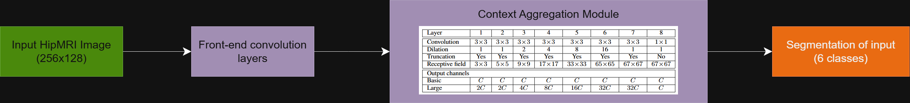

## 2. Feasibility Review
### User Need, Scope & Acceptance Criteria
The intended user is for an imaging specialist, hoping to save time on clinical contouring, by having an annotation assistant that proposes anatomical contours (for the specialist to review and adjust as needed). The dilemma being investigated is whether incorporating advanced multi-scale context (a 2D CAN) can genuinely eliminate the boundary leakage and the catastrophic failures at the superior (base) and inferior (apex) slices, or will it only polish the easy mid-gland slices at a higher cost (memory and training time). The acceptance criterias are:

- Dice Coefficient >= 0.75 on the prostate label, on the test set. 
- Dice coefficient and IoU statistics reported separately for the base, central and apex slices. 
- Report the VRAM and runtime of the CAN, and calculate the ratio of it with respect to U-Net’s. The CAN is only recommended if its apex/base dice gain over the U-net justifies the extra computation from the ratio.
  
### Model Choice & Course Concepts
The chosen model is a 2D CAN, using a basic 2D U-Net as the baseline model for comparison. The proposed dataset used for both models, is the exact same HipMRI 2D slices. The same multiclass dice loss formula will be used to calculate the loss for each model during backpropagation (since masks are multi-channel), and the same optimiser (Adam), and same epoch budget of 50 will be used. The U-net gains context by max-pooling and recovering spatial details through skip connections, while the CAN keeps full resolution and grows its receptive field with exponentially increasing dilation. Instead of using a complicated front-end like a VGG, I’ll opt for a simple sequence of convolution layers to feed into the CAN Context Module. The idea to investigate 2D over 3D was due to memory and time limitations.

### Preliminary Feasibility Evidence
The HipMRI 2D dataset has split the data in train/validate/test folders containing 11400/660/540 corresponding image and mask pairs. Slices are 256x128 with 6 labels (0-5), with the prostate label being 3 (I’m pretty sure). A small U-Net model has been built (8 channels, 64 training slices, 10 epochs), and was successfully able to be trained without error, having a training loss that fell from 0.87 to 0.71 and validation loss from 0.86 to 0.76. 

### Risks, Budget & Fallback 
Some key technical risks involved in the project include repeating the paper’s initial failed attempts using samples from random distributions [1], having small classes stay near zero dice coefficients throughout, and memory and runtime limits on the Rangpur cluster (queuing also costs time).
The provisional computing budget would be to train the U-net for 2 hours, and then the CAN for 4 hours. The next planned experiment is to fully train the U-net, and then the CAN, with matching parameters. If the CAN becomes too difficult to train, a workable fallback would to be simplify its layers, or if it’s a lost cause, then we can use the improved U-net model architecture instead. 


## 3. Repository Structure and Usage
### 3.1 Repository structure
```
2D_CAN_s48822521/
├── Dataset/keras_slices_data
│   ├── keras_slices_train/
│   ├── keras_slices_seg_train/
│   ├── keras_slices_validate/
│   ├── keras_slices_seg_validate/
│   ├── keras_slices_test/
│   └── keras_slices_seg_test/
├── Images/ 
├── train.py 
├── predict.py
├── dataset.py
├── modules.py
├── README.md
```
- `Images/`: Graphs and plots of training statistics and selected test set prediction outcomes
- `dataset.py`: Nifti loading, patient-level train/validate/test splitting, normalisation, one-hot encoding, data augmentation. Also enforces patient-level splitting.
- `modules.py`: Contains 2D CAN and baseline 2D U-Net model
- `train.py`: Training, validation, model saving, calculating loss and dice curves overtime, computing test set metrics like boundary score and inference time
- `predict.py`: Load the saved models (their weights), run it against the test set and produce segmentation and training visualisations
- `README.md`: Thorough documentation of the models chosen and their outputs

### 3.2 Running the code
Run the following commands inside of the `2D_CAN_s48822521` repository

To train and test both the two models, run:
```
python train.py --data_dir "Dataset\keras_slices_data" --model "2D U-Net" --save_path "Basic-U-Net.pt"
python train.py --data_dir "Dataset\keras_slices_data" --model "2D CAN" --save_path "Basic-2D-CAN.pt"
```
All parameters listed above do have default values as well, but it is recommended to override them yourself as
shown above. There are also hyperparameters you can tweak by passing in arguments, but all of them have default values:
- `--lr`: Set the learning rate (default is 0.0001)
- `--batch_size`: Set the batch size used by the dataloaders (default is 16)
- `--num_epochs`: Set the number of epochs used during training (default is 50)
- `--base_channels`: Set the number of base channels used in the models (default is 8)

Next, to get the statistics and graphs of the models saved, run:
```
python predict.py --data_dir "Dataset\keras_slices_data"
```
Note that the data that `predict.py` relies on is placed inside of a hidden python file: `data.py`, which contains two
variables called `U_NET_STATISTICS` and `CAN_STATISTICS`, where you copy the printed outputs from the training, in 
the format of:
```
U_NET_STATISTICS = {
    "train_loss": [],
    "validation_loss": [],
    "dice_coefficient": [
        [],
        [],
        [],
        [],
        [],
        []
    ]
}

CAN_STATISTICS = {
    "train_loss": [],
    "validation_loss": [],
    "dice_coefficient": [
        [],
        [],
        [],
        [],
        [],
        []
    ]
}
```

### 3.3 Example Use Demonstration
- Input: A 256x128 HipMRI slice image
- Output: A 6-class segmentation mask
    - classID = 0: Background
    - classID = 1: Body
    - classID = 2: Bone
    - classID = 3: Bladder
    - classID = 4: Rectum
    - classID = 5: Prostate

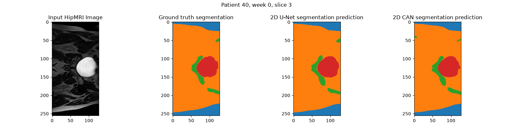

## 4. Dependencies and Reproducibility
### 4.1 Versions
- `python`: 3.11.15
- `torch`: 2.14.0
- `torchvision`: 0.29.0
- `numpy`:  2.4.6
- `nibabel`: 5.4.2
- `matplotlib`: 3.11.1
- `scipy`: 1.17.1

### 4.2 Hardware and runtime
- GPU: Trained using Nvidia A100 on the Rangpur cluster, via a job script and using sbatch
- Training time:
  - 102.50 minutes for 2D U-Net
  - 123.74 minutes for 2D CAN
- The batch file used to train the 2D CAN model on the Rangpur cluster is shown below:
  ```
  #!/bin/bash
  #SBATCH --job-name=2D-CAN-Training
  #SBATCH --partition=comp3710
  #SBATCH --account=comp3710
  #SBATCH --gres gpu:1
  #SBATCH --time=04:00:00
  #SBATCH --output=slurm_%j.out
  #SBATCH --error=slurm_%j.err
  
  # Activate your conda environment
  source $HOME/miniconda3/bin/activate
  conda activate torch
  export LD_LIBRARY_PATH=$CONDA_PREFIX/lib:$LD_LIBRARY_PATH
  
  python train.py --data_dir /home/groups/comp3710/HipMRI_Study_open/keras_slices_data --model "2D CAN" --save_path "Basic-2D-CAN.pt" --num_epochs 50 --base_channels 32 --batch_size 16
  ```

### 4.3 Hyperparameters for reproducibility
The hyperparameters I used to train the models are shown below:
- `learning_rate = 0.0001`
- `num_epochs = 50`
- `base_channels = 32`
- `batch_size = 16`

## 5. Data and Pre-processing
### 5.1 About the Dataset
- The dataset of 2D HipMRI slices can be found on the Rangpur cluster at `/home/groups/comp3710/HipMRI_Study_open/keras_slices_data`
- There are 42 patients with varying number of weeks available, but each week has 60 slices. Each slice is a 256x128 greyscale image. There are also corresponding segmentation mask labels for each image, which has 6 classification IDs
  - 0: background
  - 1: body
  - 2: bone
  - 3: bladder
  - 4: rectum
  - 5: prostate
- There is a huge class imbalance, with classes 4 and 5 rarely appearing overall. 

### 5.2 Pre-processing
- Intensity normalisation using z-scores to ensure stability
- One-hot encoding of the labels
- Data augmentation, consisting of horizontal flips and 15 degree offset rotations. Applied to both the image and the segmentation label
- Used the provided train|validate|test split, which has a ratio of `11400|660|540`, which roughly follows the standard `90%|5%|5%` split. The train set was used for updating the weights, the validate set was used for evaluating the model during runtime (updating hyperparameters as needed), and the test set was used to see if the model generalised well, with reported statistics.
- Ensured there was patient-level splitting, implemented via code as well. So, all slices and all weekly scans of one patient are placed in the same set.

## 6 Model changes with respect to papers
### 2D U-Net
The following changes deviated from the U-Net model provided in [2]:
- Batch normalisation
- LeakyReLU activation function
- `padding=1` instead of `padding=0` to preserve spatial size as we go through convolutions (rather than it shrinking)

### 2D CAN
The following changes deviated from the U-Net model provided in [1]:
- Batch normalisation
- LeakyReLU activation function
- Just used a simple series of 3 `3x3` convolutions as the front-end of this model's architecture instead, which then gets fed into the context module. 

## 7. Investigation of the Open Research Dilemma
### 7.1 Baseline 2D U-Net vs 2D CAN
| Class |	U-Net Dice | CAN Dice |	U-Net IoU	| CAN IoU | U-Net BF Score | CAN BF Score |
|---|---|---|---|---|---|---|
Background |	0.9749	| 0.9735 |	0.9509 |	0.9483 | 0.8529 | 0.8461 
Body |	0.9802 |	0.9790 |	0.9611 | 0.9588 | 0.9546 | 0.9459
Bone |	0.9366 |	0.9314 |	0.8808 | 0.8717 | 0.9184 | 0.8993
Bladder |	0.9637 |	0.9649 |	0.9300 | 0.9322 | 0.9483 | 0.9163
Rectum |	0.8474 |	0.8562 |	0.7351 | 0.7486 | 0.7666 | 0.7935
Prostate |	0.8681 |	0.8729 | 0.7670	| 0.7745 | 0.7538 | 0.7342

Table of per-class Dice, IoU and Boundary scores, on the same test split, for both models.

### 7.2 Resource Profiling
| Model | Parameters | Peak VRAM | Inference time/slice | Training time |
|---|---|---|---|---|
2D U-Net |	~7.8M	| 170.29 MB |	0.00319 s (3.19 ms) |	102.50 min
2D CAN	| ~11.3M | 100.42 MB | 0.00243 s (2.43 ms) | 123.74 min

### 7.3 Training Statistics
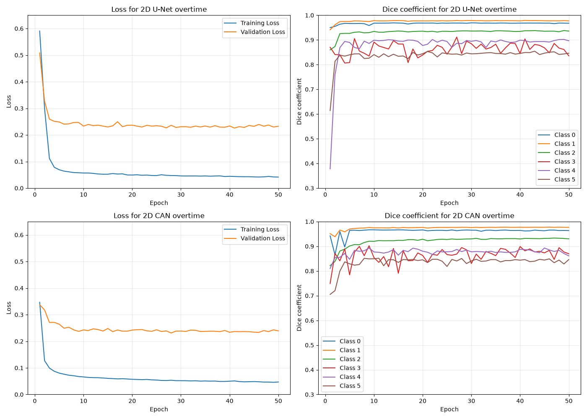

### 7.4 Failure Cases
The red shows false negatives, while the blue shows false positives in the overlap difference images.
As for the segmentation colouring:
- `class 0 = blue`
- `class 1 = orange`
- `class 2 = green`
- `class 3 = red`
- `class 4 = purple`
- `class 5 = brown`

#### 7.4.1 Failure Case #1
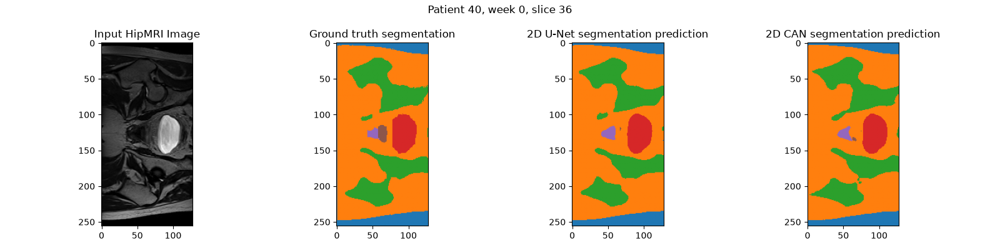
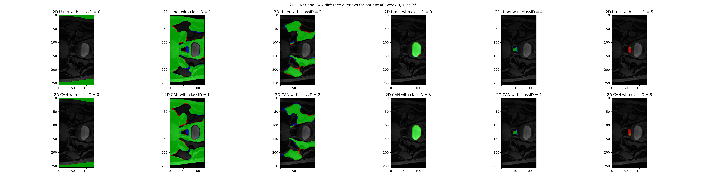
This slice at the base shows a large false negative for the prostate gland for both models (the model underestimated the amount of prostate in the image). The likely root trigger appears to be that the prostate lands in between both the bladder and the rectum, and the prostate isn't very large in this image (smallest of the 3). Additionally, all 3 look very similar in the MRI image, so its hard to distinguish

While both models couldn't really detect the prostate, the CAN model was able to sizably detect more of the prostate than the 2D U-Net.

#### 7.4.2 Failure Case #2
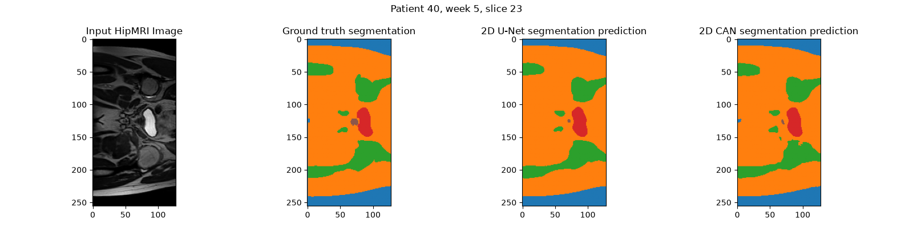
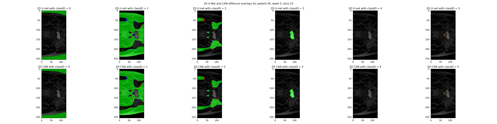
This slice at the base shows another false negative for both models. The likely root trigger appears to be that the prostate is just very small here, and that it is directly below the bladder, which can make the transition between the transition and the prostate hard and blurry.

Both models roughly detected the same amount of prostate existence in the image.

#### 7.4.2 Failure Case #3
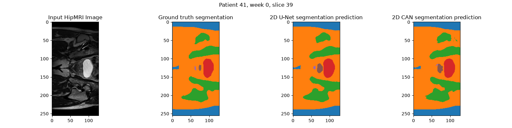
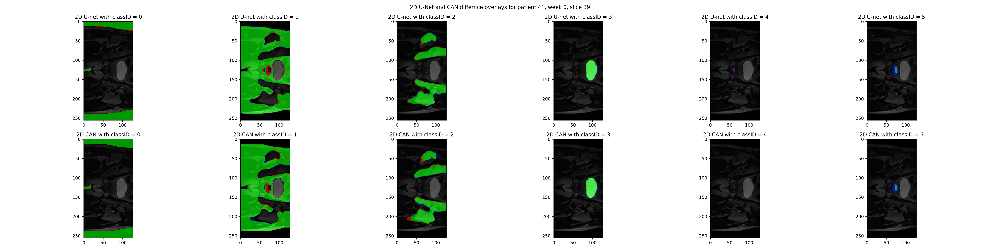
This slice at the base shows a false positive for both models (the model overestimated the amount of prostate in the image). The likely root trigger is that the low contrast between the small prostate and the adjacent bladder makes the true boundary difficult to find at the pixel level. Another explanation could be that the network has learnt a typical prostate gland shape and size from the various mid-gland slices, and choose to apply it wrongly where the gland tapers at the base/apex (since that might be an over-representation).

An important discovery here was that the 2D CAN model's prostate boundary was more accurate to the ground truth segmentation (didn't overestimate as much).

#### 7.4.2 Failure Case #4
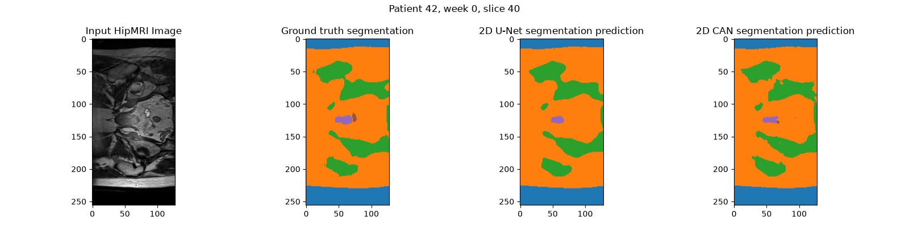
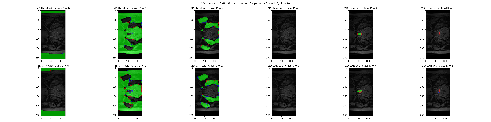
This slice at the apex shows a false negative for both models. The likely root trigger is that the target segmentation for the prostate is a very small and narrow area, and the low intensity contrast against the adjacent rectal wall makes the boundary difficult to resolve. 

An important discovery here was that the 2D CAN model was able to detect there was prostate in the image while the 2D U-Net could not. 

### 7.5 Recommendation to Project Manager
In terms of accuracy, the 2D CAN model essentially performed at the same level as the 2D U-Net model. It scored a 0.8729 dice coefficient as opposed to U-Net's 0.8681, but CAN's boundary value of 0.7342 was slightly lower compared to U-Net's 0.7538. CAN took about 20 minutes longer to train, but at inference time, it used 70MB less peak VRAM and was 0.7ms faster per slice. These efficiency differences are marginal. Since CAN did not reduce the boundary errors seen with the U-Net (See section 6.4), it's multi-scale context is not justified on accuracy grounds for an operational contouring pipeline.
Despite the faster runtime, the fact that it did not adequately eliminate the hazardous boundary errors that the standard 2D U-Net had, does not justify that advanced multi-scale context should be used in an operational contouring pipeline. 

However, since the entire purpose of the model is to serve as an annotation assistant, the model only needs to provide a draft that a specialist corrects. The concern with its usage is that, in the failure cases examined, both models either under-contoured or over-contoured the prostate near the base and apex. Therefore, I recommend these slices be flagged for mandatory manual review. If a single model must be deployed, CAN has a slight efficiency advantage at the same accuracy, but this is a tie-breaker and not a strong reason to prefer it.


## 8. Artificial Intelligence Usage Disclosure
No AI generation was used for this assignment.

## 9. References
1. [1] F. Yu and V. Koltun, “Multi-scale context aggregation by dilated convolutions,” in Proc. ICLR, 2016.
2. [2] O. Ronneberger, P. Fischer, and T. Brox, “U-Net: Convolutional networks for biomedical image segmentation,” in Proc. MICCAI, 2015, pp. 234–241.
